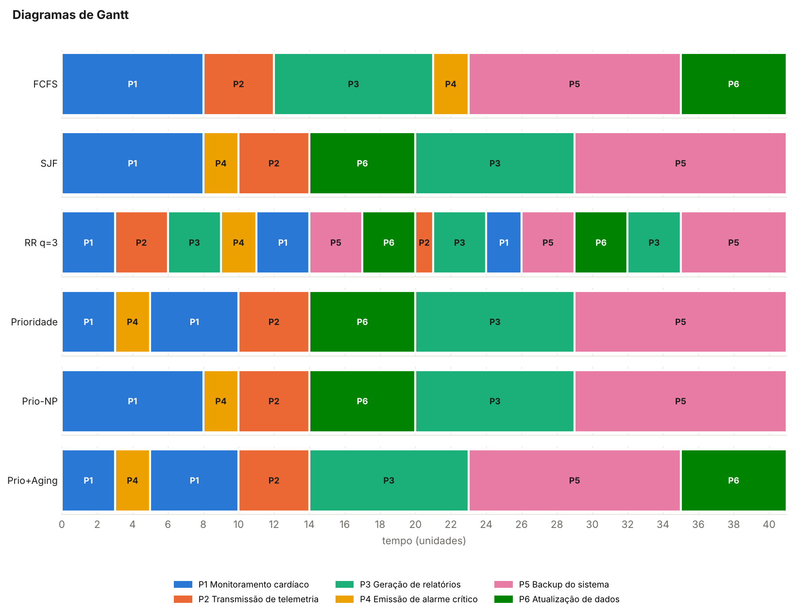
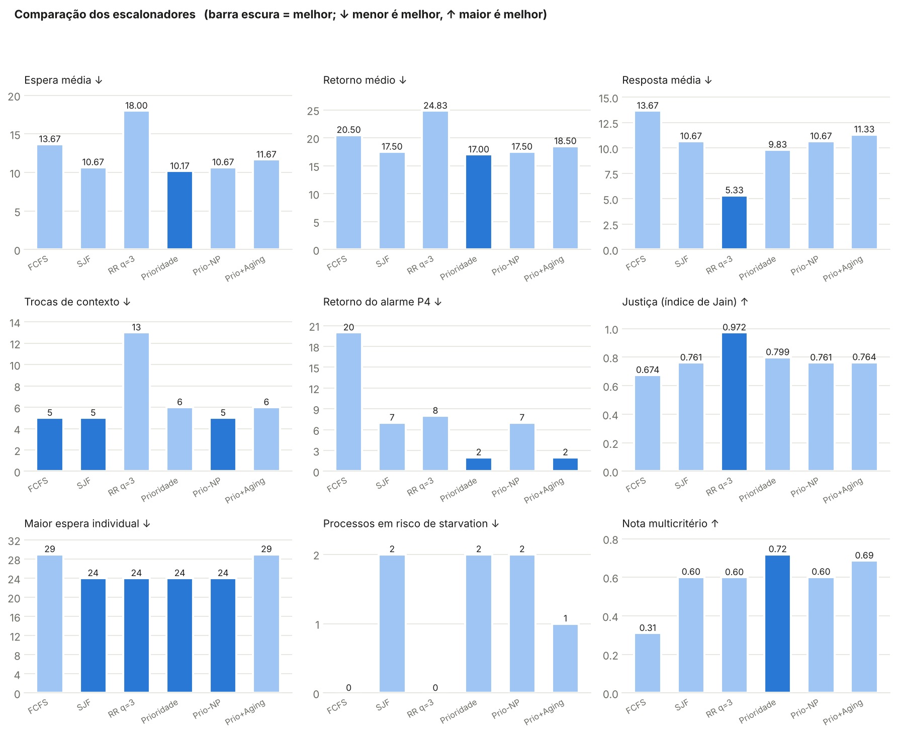
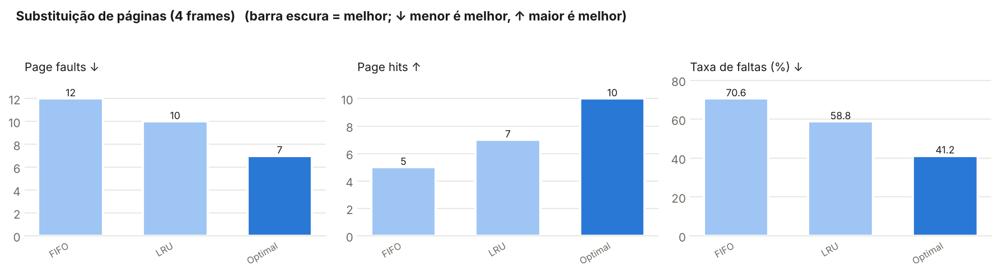

# KernelLab — Simulador de Gerenciamento de Recursos (MedControl)

Simulador em Python que reproduz as decisões de um sistema operacional — escalonamento de CPU, substituição de páginas e controle de acesso a dispositivos — e mede o impacto de cada algoritmo no cenário da **MedControl**, onde monitoramento cardíaco, telemetria e alarmes críticos disputam os mesmos recursos que tarefas administrativas (relatórios, backup, atualização).

> Projeto da disciplina **Sistemas Operacionais** — Engenharia da Computação (UNIFECAF).
> Autor: Kaio Santana Rodrigues Santos.
> Relatório técnico (parte teórica): [`docs/Relatorio_Tecnico_KernelLab.pdf`](docs/Relatorio_Tecnico_KernelLab.pdf)

---

## 1. Problema e objetivo

Num equipamento hospitalar, a ordem em que o SO entrega a CPU, a memória e os dispositivos não é detalhe técnico: um alarme crítico que espera 18 unidades de tempo atrás de um relatório é um risco ao paciente. O objetivo do KernelLab é **simular** essas decisões com os dados reais do cenário e **comparar** as políticas por desempenho, prioridade, justiça e criticidade — não por uma única métrica.

Fluxo do simulador:

```
Entrada dos processos → Escalonamento da CPU → Métricas → Memória → Dispositivos → Comparação/Recomendação
```

## 2. Arquitetura

```
kernellab/
├── src/
│   ├── main.py           # CLI: orquestra o fluxo, imprime tabelas e salva resultados
│   ├── models.py         # dataclass Process + leitura/validação dos JSON
│   ├── schedulers.py     # FCFS, SJF, Round Robin, Prioridade (+ variantes)
│   ├── metrics.py        # espera, retorno, resposta, trocas, justiça, starvation, comparação
│   ├── memory.py         # FIFO, LRU e Optimal
│   ├── devices.py        # matriz de acesso, fila FIFO + semáforo, demo com threads
│   └── visualization.py  # tabelas, Gantt em texto e gráficos PNG
├── data/
│   ├── processes.json        # tabela de processos
│   ├── config.json           # quantum, aging, frames, sequência de páginas, pesos
│   ├── access_matrix.json    # dispositivos, capacidades e permissões
│   └── device_requests.json  # solicitações concorrentes aos dispositivos
├── tests/                # 32 testes (pytest) com valores calculados à mão
├── docs/                 # imagens e saída de exemplo
├── requirements.txt
└── README.md
```

Princípio de projeto: **algoritmos não conhecem os dados**. Os escalonadores só devolvem a linha do tempo (segmentos do Gantt); `metrics.py` calcula tudo a partir dela. Assim dá para trocar processos, quantum, frames ou páginas editando só os arquivos de `data/` ou passando argumentos na linha de comando.

## 3. Algoritmos implementados

### CPU (Etapas 1 e 2)
| Algoritmo | Tipo | Observação |
|---|---|---|
| **FCFS** | não preemptivo | fila por ordem de chegada |
| **SJF** | não preemptivo | menor burst entre os prontos |
| **Round Robin** | preemptivo | quantum configurável (padrão 3) |
| **Prioridade** | preemptivo | menor número = maior prioridade; alarme assume a CPU ao chegar |
| Prioridade não preemptiva | variante | para comparar o efeito da preempção |
| Prioridade + aging | variante | prioridade melhora 1 nível a cada *N* unidades de espera, sem alcançar o nível do alarme |

Convenções: tempo discreto; empates resolvidos por chegada e depois pela ordem no arquivo; no RR, quem chega no mesmo instante em que um quantum expira entra na fila antes do processo preemptado; troca de contexto = mudança de um processo para outro diferente (a carga inicial não conta).

Métricas por processo: tempo de espera, retorno, resposta, retorno normalizado. Por algoritmo: médias, trocas de contexto, utilização, **índice de justiça de Jain** e sinalização de:
- **atraso excessivo** — espera > 1,5 × média ou retorno normalizado ≥ 4;
- **risco de starvation** — o processo foi ultrapassado por processos que chegaram depois e esperou pelo menos a média.

A comparação responde às seis perguntas da Etapa 2 e calcula uma **nota multicritério** (pesos em `config.json`: alarme 30%, espera 20%, resposta 15%, justiça 15%, starvation 10%, trocas 10%).

### Memória (Etapa 3)
**FIFO**, **LRU** e **Optimal** (referência teórica), com estado dos frames após cada referência, hits, faults e taxa de faltas.

### Dispositivos (Etapa 4)
- Matriz de controle de acesso (R ler, W gravar, X executar, U utilizar, E exclusivo) para disco, rede, áudio e logs, pelo princípio do menor privilégio.
- Cada dispositivo tem uma **fila FIFO** e um **semáforo contador** (disco, áudio e logs = mutex; rede = 2 vagas). Pedidos exclusivos só entram com o dispositivo vazio. Pedidos sem permissão são negados antes de entrar na fila.
- O simulador verifica as invariantes de exclusão mútua a cada instante e relata violações (resultado esperado: nenhuma).
- Demonstração com **threads reais**: contador do arquivo de log com e sem `threading.Lock`, mostrando atualizações perdidas por condição de corrida.

## 4. Instalação e execução

Requisitos: Python 3.10+.

```bash
git clone https://github.com/kaiooo20/kernellab.git
cd kernellab
python -m venv .venv
# Linux/macOS: source .venv/bin/activate
# Windows:     .venv\Scripts\activate
pip install -r requirements.txt
python src/main.py
```

A saída aparece no terminal e também é salva em `output/` (`resultados.txt`, `resultados.json`, `gantt.png`, `escalonadores.png`, `memoria.png`). O `matplotlib` é opcional: sem ele, tudo funciona e só os PNG não são gerados.

## 5. Formato dos dados de entrada

`data/processes.json`
```json
{"processes": [
  {"pid": "P1", "name": "Monitoramento cardíaco", "arrival": 0, "burst": 8,
   "priority": 1, "memory_mb": 120, "devices": ["rede"]}
]}
```

`data/config.json`
```json
{"scheduling": {"quantum": 3, "aging_interval": 4, "aging_floor": 1, "critical_pid": "P4"},
 "analysis":   {"excessive_wait_factor": 1.5, "excessive_normalized_turnaround": 4.0},
 "memory":     {"frames": 4, "reference_string": [1,2,3,4,1,2,5,1,2,3,4,5,2,1,5,3,2]},
 "recommendation_weights": {"avg_waiting": 0.2, "avg_response": 0.15, "critical_response": 0.3,
                            "fairness": 0.15, "starvation": 0.1, "context_switches": 0.1}}
```

`data/access_matrix.json` — `"devices"` com a capacidade de cada um e `"matrix"` com as permissões por processo (`"P4": {"audio": "WXUE"}`).

`data/device_requests.json` — lista de pedidos `{"pid", "device", "time", "duration", "op", "exclusive"}`.

## 6. Exemplos de uso

```bash
python src/main.py                                   # tudo, com os dados padrão
python src/main.py --quantum 4                       # outro quantum
python src/main.py --aging 0                         # desliga a variante com aging
python src/main.py --section memory --frames 3 --pages 7,0,1,2,0,3,0,4,2,3
python src/main.py --section devices                 # só a Etapa 4
python src/main.py --processes meus_processos.json   # outra carga
python src/main.py --no-variants --no-charts         # só os 4 algoritmos, sem PNG
python src/main.py --help
```

## 7. Testes

```bash
python -m pytest -v
```

32 testes cobrem: ordem de execução e tempos de cada escalonador (valores calculados à mão), quantum configurável, CPU ociosa, efeito do aging, sinalização de starvation, respostas da comparação, faults/hits de FIFO/LRU/Optimal, Optimal como limite inferior, anomalia de Belady no FIFO, matriz de acesso, exclusão mútua no disco, semáforo da rede, pedidos negados, lock com threads e a CLI com parâmetros personalizados.

## 8. Resultados principais (dados padrão)



| Algoritmo | Espera méd. | Retorno méd. | Resposta méd. | Trocas | Resposta do alarme P4 | Jain | Starvation |
|---|---:|---:|---:|---:|---:|---:|---|
| FCFS | 13,67 | 20,50 | 13,67 | 5 | 18 | 0,674 | — |
| SJF | 10,67 | 17,50 | 10,67 | 5 | 5 | 0,761 | P3, P5 |
| RR (q=3) | 18,00 | 24,83 | **5,33** | 13 | 6 | **0,972** | — |
| **Prioridade (preemptiva)** | **10,17** | **17,00** | 9,83 | 6 | **0** | 0,799 | P3, P5 |
| Prioridade não preemptiva | 10,67 | 17,50 | 10,67 | 5 | 5 | 0,761 | P3, P5 |
| Prioridade + aging (4) | 11,67 | 18,50 | 11,33 | 6 | **0** | 0,764 | P3 |

- **Menor espera média:** Prioridade preemptiva (10,17).
- **Melhor tempo de resposta:** Round Robin (5,33).
- **Alarme tratado com mais eficiência:** Prioridade preemptiva — resposta 0, retorno 2 (no FCFS o alarme espera 18).
- **Maior risco de starvation:** SJF e Prioridade — P3 (relatórios) e P5 (backup) são sempre ultrapassados.
- **Mais justo:** Round Robin (Jain 0,972), à custa de 13 trocas de contexto e de atrasar o alarme.
- **Mais adequado à MedControl:** Prioridade preemptiva (maior nota multicritério, 0,72), operada **com aging**.



**Memória** (4 frames, 17 referências):

| Algoritmo | Faults | Hits | Taxa de faltas |
|---|---:|---:|---:|
| FIFO | 12 | 5 | 70,59% |
| LRU | 10 | 7 | 58,82% |
| Optimal | 7 | 10 | 41,18% |

LRU é o melhor algoritmo implementável: aproveita a localidade temporal (as páginas 1, 2 e 5 voltam com frequência), enquanto o FIFO expulsa páginas antigas mesmo quando são as mais usadas. O Optimal precisa conhecer o futuro e serve apenas como limite inferior.



**Dispositivos:** 15 pedidos, 3 negados pela matriz de acesso (P3 na rede, P2 no áudio, P6 pedindo disco exclusivo), nenhuma violação de exclusão mútua; o backup obtém o disco exclusivo só depois que o relatório libera. Na demonstração com threads, sem lock centenas de gravações no contador do log se perdem; com `threading.Lock`, nenhuma.

A saída completa está em [`docs/resultados_exemplo.txt`](docs/resultados_exemplo.txt).

### Recomendação técnica
Adotar **escalonamento por prioridade preemptivo com aging**: o alarme crítico (prioridade 0) assume a CPU no instante em que chega, monitoramento e telemetria vêm em seguida, e o aging garante que relatórios e backup não esperem indefinidamente sob carga contínua (o aging nunca eleva um processo ao nível do alarme). Para processos da mesma classe, o Round Robin pode ser usado internamente (filas multinível). Na memória, LRU (ou aproximações como o algoritmo do relógio). Nos dispositivos, menor privilégio na matriz de acesso e mutex/semáforo por dispositivo.

## 9. Limitações e possíveis melhorias

- CPU única, sem custo de troca de contexto e sem bloqueio por E/S; bursts conhecidos de antemão (o SJF real precisa estimá-los, por exemplo por média exponencial).
- Memória e dispositivos são simulados de forma independente do escalonador (não há page fault bloqueando o processo).
- A fila dos dispositivos é FIFO pura: o alarme pode esperar o disco/rede; uma melhoria é fila por prioridade com herança de prioridade e detecção de deadlock.
- Tempo discreto e uma única carga de trabalho: as conclusões podem mudar com outras cargas — por isso tudo é parametrizável.
- Melhorias: SRTF e filas multinível com realimentação, algoritmo do relógio (Second Chance), interface web, geração de cargas aleatórias para análise estatística.

## 10. Referências

- TANENBAUM, A. S.; BOS, H. *Sistemas Operacionais Modernos*. 4. ed. Pearson.
- SANTANA, M. *Sistemas multiprogramados* — Organização e Arquitetura de Computadores II, UNIVASF.
- ENDLER, M. *INF 1316 — Sistemas Operacionais*, PUC-Rio.
- Tecnoblog. *O que é um sistema operacional?*
- Materiais da disciplina Sistemas Operacionais (AVA UNIFECAF).
